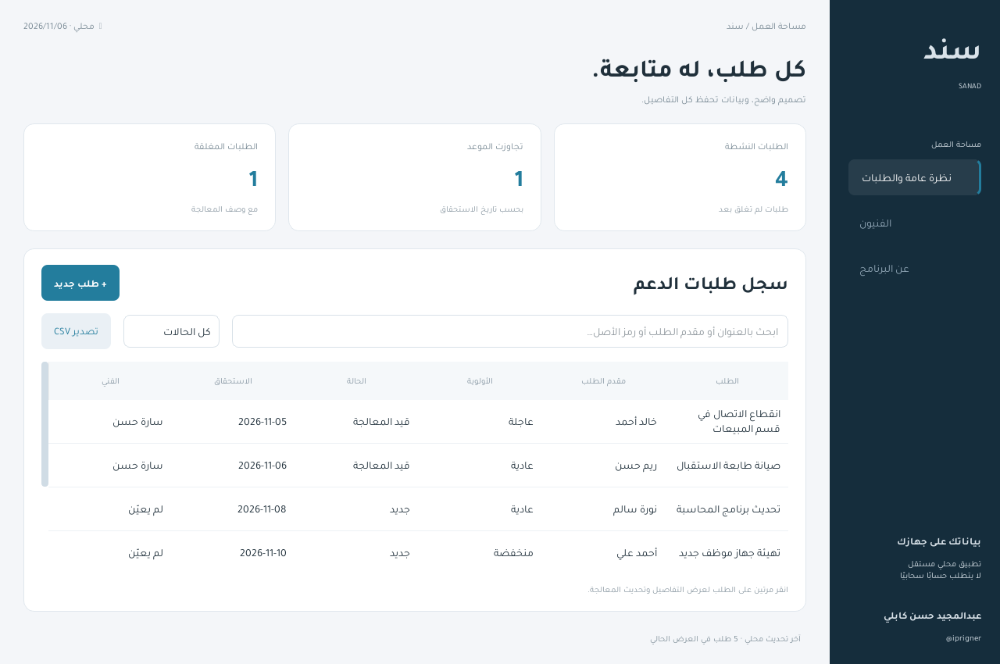

# سند · Sanad

تطبيق ويندوز محلي لإدارة طلبات الدعم والصيانة، بواجهة عربية واتجاه من اليمين إلى اليسار. مشروع تجريبي لعبدالمجيد حسن كابلي (@iprigner).



## المزايا

- إنشاء طلب بعنوان ومقدم طلب ورمز أصل وتصنيف وأولوية وموعد استحقاق.
- تعيين الفني وتوثيق المعالجة؛ الإغلاق يتطلب فنيًا ووصفًا للحل.
- حالات متابعة، وبحث وفلاتر، وإحصاءات مبنية على قاعدة البيانات.
- سجل لكل عملية تحديث، ورفض التعديل المتأخر إذا تغير إصدار الطلب.
- حفظ محلي في SQLite وتصدير CSV بترميز يدعم العربية وحماية من صيغ الجداول.

## التشغيل

نسخة ويندوز المبنية موجودة في مجلد «برنامج التشغيل» بجانب مجلد الشيفرة عند التسليم. شغّل Sanad.exe؛ لا تحتاج Python لتشغيل هذه النسخة.

لتشغيل الشيفرة، استخدم Python 3.12 أو أحدث على ويندوز:

```sh
python -m venv .venv
.venv\Scripts\python -m pip install -r requirements.txt
.venv\Scripts\python main.py
```

البيانات الافتراضية تحفظ ضمن مجلد بيانات التطبيق المحلي للمستخدم (`AppLocalDataLocation`)، خارج مجلد المستودع. يمكن تحديد مجلد مستقل باستخدام `--data-dir PATH`. لا تُرسل سجلاتك إلى أي خدمة.

البرنامج يبدأ دون طلبات. لإضافة أمثلة، افتح «عن البرنامج» ثم «إضافة بيانات تجريبية»، أو شغّل `python main.py --demo`. تُرفض إضافة الأمثلة إن كانت الطلبات موجودة بالفعل.

## الاختبارات

```sh
python -m unittest discover -s tests -v
```

تغطي قواعد تعيين الفني والإغلاق، رفض التعديلات المتأخرة، التراجع عن عملية فاشلة، البحث، استمرار البيانات بعد إعادة الفتح، CSV، وإنشاء طلب من نافذة الواجهة. الواجهة التجريبية تختبر بواسطة QtTest مع منصة offscreen، دون الحاجة للتحكم في شاشة المستخدم.

## البناء إلى EXE

```sh
python -m pip install -r requirements-dev.txt
python build.py
```

البناء يتم على ويندوز. ملف EXE تجريبي غير موقّع بشهادة تجارية. كاش البناء وقواعد البيانات والملفات التنفيذية مستبعدة من مستودع المصدر.

## حدود النسخة

تطبيق محلي لمشغّل واحد، دون تسجيل حسابات أو صلاحيات فرق أو بريد أو مزامنة شبكة. لا يعاد فتح الطلب المغلق؛ يُنشأ طلب متابعة. لا يوجد ادعاء بنشر النظام أو استخدامه عند عميل فعلي. راجع الشيفرة والاختبارات قبل مناقشتها في مقابلة؛ استُخدمت مساعدة برمجية بالذكاء الاصطناعي أثناء إعداد المشروع.

التقنيات: Python، PySide6 / Qt Widgets، SQLite، unittest، QtTest، PyInstaller. رخصة خط Tajawal محفوظة في `assets/FONT-LICENSE.txt`؛ اختيار رخصة الشيفرة متروك لصاحب المشروع.
